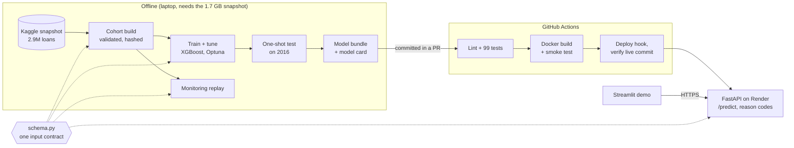

# Lending Club default risk: from data audit to a monitored production service

A probability-of-default model for 36-month personal loans, built end to end: a data audit,
an out-of-time evaluation fixed in advance, a calibrated XGBoost model with reason codes, a
FastAPI service deployed by CI/CD, and a monitoring replay that shows when a model failure
would have been caught.

**Live API:** <https://lending-club-loan-default-predict.onrender.com> (interactive docs) ·
[Model card](models/lc-default-risk/model_card.md) ·
[Monitoring report](docs/monitoring/report.md) · [Architecture](docs/architecture.md)

> The API runs on Render's free tier: the first request after ~15 idle minutes takes 30–60 s
> while the service wakes up.

## Results

Out-of-time test on 318,223 loans issued in 2016, scored once with rules
[fixed before testing](docs/model_selection.md). The model uses neither LC's own grade, the
interest rate, nor the applicant's state.

| | this model | logistic baseline | LC's own sub-grade |
|---|---|---|---|
| AUC | **0.688** | 0.679 | 0.672 |
| Default rate when approving the best 80% | **12.34%** | 12.57% | 12.73% |
| Realized return on that book | **+7.06%** | +6.84% | +6.46% |

## What is worth looking at

1. **Auditing before modeling.** The original course project tested on a vintage that was only
   71% resolved and chose its threshold on the test set. The [data audit](discovery/reports/data_audit.md)
   measured label maturity by vintage and schema roll-out by year, and those findings set the
   cohort and the split.
2. **Locating the performance ceiling.** Doubling the data adds about +0.004 AUC, ten hand-built
   features add +0.0014, and tuning barely matters, while LC's grade, which carries information
   these inputs lack, adds +0.012. The limit is the information in the inputs, not the model
   ([model card](models/lc-default-risk/model_card.md#where-the-performance-ceiling-is)).
3. **A fairness fix, measured.** v1.0.0's reason codes often blamed the applicant's state.
   Removing it cost −0.0011 AUC (95% CI −0.0018 to −0.0004) and left lending outcomes
   unchanged ([amendment](docs/model_selection.md#amendment-1--remove-addr_state-decided-before-training-v110)).
4. **Monitoring that catches what drift checks miss.** Replaying 2016 month by month, no
   input- or score-drift alert ever fired, yet the model degraded. Early-default AUC (readable
   about a year after issue) flagged it **28 months** before lifetime outcomes could
   ([playbook](docs/monitoring/README.md)).
5. **One contract, verified end to end.** Every stage reads its fields from
   [`schema.py`](src/lc_risk/schema.py). CI checks that HTTP scoring matches offline scoring to
   within 1e-6 and loads the committed model bundle. Deployment ends with a check that the
   live service reports the exact commit CI tested.

## Architecture



Details on each piece: [docs/architecture.md](docs/architecture.md).

## Repository map

```
src/lc_risk/
  schema.py           the input contract: every field once, read by every stage
  data/               cohort build: stream, filter, parse, validate, hash
  features.py         raw fields -> model features (stateless, shared by training and serving)
  model.py            RiskModel: pipeline + calibration + TreeSHAP reason codes
  training/           train (Optuna), evaluate (once), diagnostics, release
  serving/            FastAPI app and request/response models
  monitoring/         PSI drift, early/final performance, alert rules, 2016 replay
app/                  Streamlit demo: a thin client of the live API
discovery/            data audit scripts, published audit report, EDA notebook
models/lc-default-risk/  released model bundle, model card, test report
docs/                 architecture, model selection protocol, monitoring playbook and report
tests/                99 tests on synthetic data and the committed bundle (~8 s)
```

## Running it

```bash
uv sync --all-groups --all-extras && uv run pytest        # the same tests CI runs

docker build -t lc-default-risk . && docker run -p 8000:8000 lc-default-risk
uv run streamlit run app/streamlit_app.py                 # demo; LC_API_URL picks the API
```

<details>
<summary>Rebuilding the data, model and reports (needs the Kaggle snapshot)</summary>

```bash
uv run python discovery/run_data_discovery.py             # download + audit -> discovery/reports/
uv run python -m lc_risk.data.cohort                      # -> data/interim/cohort.parquet
uv run jupyter nbconvert --to notebook --execute --inplace discovery/eda.ipynb

uv run python -m lc_risk.training.train --trials 30 --run-id <id>    # ~40 min
uv run python -m lc_risk.training.evaluate --run <id>                # refuses a second run
uv run python -m lc_risk.training.diagnostics --run <id>
uv run python -m lc_risk.training.release --run <id> --model xgboost_A --version <x.y.z>

uv run python -m lc_risk.monitoring.simulate              # -> docs/monitoring/report.md
```
</details>

## Background

This began as a five-person course project; that version is preserved at the tag
[`v1-course-project`](../../tree/v1-course-project). The v2 rebuild is my own. It replaced the
original pipeline after the audit above, dropped the Databricks notebooks and the MCP server,
and added the serving, CI/CD, and monitoring layers.

**Known limitations** (from the [model card](models/lc-default-risk/model_card.md#limitations-and-risks)):
the data covers approved loans only, so there is no reject inference. Calibration drifts as
default rates rise. `pct_tl_nvr_dlq` and `mo_sin_old_il_acct` show counter-intuitive effects
that a monotone constraint should fix in the next version.
