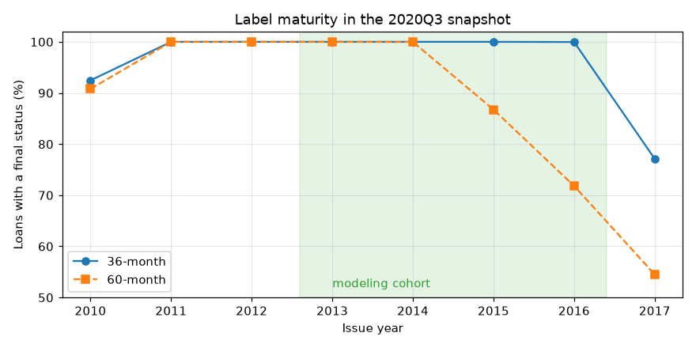

# Raw data audit

> Generated by `discovery/05_write_audit_report.py` on 2026-10-23 from the outputs of
> stages 01–04. Do not edit by hand; rerun `python discovery/run_data_discovery.py`.

This report answers one question: **which loans and which columns can a default model
trust?** Each section ends with the decision it led to; section 6 shows where each decision
lives in code.

## 1. Source

| | |
|---|---|
| Dataset | Kaggle `ethon0426/lending-club-20072020q1` |
| Raw file | `data/raw/Loan_status_2007-2020Q3.gzip` (1.77 GB) |
| SHA-256 | `5878af2a088f8ab5…` |
| Shape | 2,925,493 loans × 142 columns |
| Issue years | 2007–2020 (snapshot taken 2020Q3) |

## 2. Data quality

The export is clean at the row level: loan IDs are unique, and only a handful of values are
impossible.

| check | value | severity |
|---|---|---|
| unique_id_count | 2,925,493 | info |
| duplicate_id_hash_count | 0 | pass |
| unparsed_issue_d | 1 | review |
| blank_business_rows | 0 | review |
| funded_amnt_gt_loan_amnt | 0 | pass |
| fico_low_gt_high | 0 | pass |
| negative_dti | 2 | warning |
| negative_annual_inc | 0 | pass |
| negative_open_acc | 0 | pass |
| revol_util_gt_200 | 2 | warning |

**Decision:** impossible values (negative DTI, revolving utilization above 200%, non-positive
income, the DTI sentinel 999) become null, and every rule's hit count is recorded in the
cohort manifest.

## 3. Label maturity: which loans have a trustworthy outcome?

A loan's label (paid off or charged off) is only known once the loan is resolved. The
snapshot was taken in 2020Q3, so recent and long-term loans are often still running.

| issue year | term | loans | final status | still current | charge-off rate (resolved) |
|---|---|---|---|---|---|
| 2012 | 36m | 43,470 | 100.0% | 0 | 13.6% |
| 2012 | 60m | 9,897 | 100.0% | 0 | 27.7% |
| 2013 | 36m | 100,422 | 100.0% | 0 | 12.3% |
| 2013 | 60m | 34,392 | 100.0% | 0 | 25.1% |
| 2014 | 36m | 162,570 | 100.0% | 0 | 13.7% |
| 2014 | 60m | 73,059 | 100.0% | 4 | 26.6% |
| 2015 | 36m | 283,173 | 100.0% | 0 | 14.9% |
| 2015 | 60m | 137,922 | 86.7% | 17,505 | 31.4% |
| 2016 | 36m | 323,495 | 100.0% | 30 | 15.9% |
| 2016 | 60m | 110,912 | 71.8% | 30,090 | 34.8% |
| 2017 | 36m | 320,419 | 77.1% | 70,272 | 17.2% |
| 2017 | 60m | 123,160 | 54.5% | 53,795 | 35.0% |

Keeping only the resolved loans from an immature vintage does not fix this. Loans resolve
early because they either default quickly or are prepaid, so the kept sample is biased
toward both extremes. 36-month loans issued through 2016 are almost fully resolved, while
60-month loans lag by about two years.

**Decision:** model 36-month loans issued 2013–2016.
The 60-month book would need its own, earlier cohort.

## 4. Column taxonomy: what is known at application time?

Every column was classified by when its value exists relative to the lending decision.

| category | columns | input candidates | what it is |
|---|---|---|---|
| credit_bureau | 82 | 81 | Bureau attributes pulled at application |
| post_origination | 32 | 0 | Payments, recoveries, hardship, settlement |
| applicant | 10 | 7 | Self-reported by the applicant |
| funding_or_listing | 4 | 0 | Funding amounts, listing status, issue date |
| identifier | 3 | 0 | IDs and URLs |
| loan_request | 3 | 3 | Amount, term, purpose |
| lc_internal_rating | 2 | 0 | LC grade / sub-grade |
| pricing_output | 2 | 0 | Interest rate, installment |
| verification_process | 2 | 2 | LC income verification |
| administrative | 1 | 0 | Platform policy code |
| target_source | 1 | 0 | Loan status |

Post-origination fields (payments, recoveries, settlements) leak the outcome. LC's grade
and interest rate are outputs of LC's own risk model, so using them as inputs would
mostly reproduce LC's model.

**Decision:** inputs are application and bureau fields only. `sub_grade` is added in
Model B alone, to measure what LC's rating contributes on top. `int_rate` is kept for
evaluation, never as an input. Section 5 narrows the candidates further.

## 5. Schema availability: when did LC start populating each field?

Median non-null rate by issue year for the input candidates:

| group | fields | 2012 | 2013 | 2014 | 2015 | 2016 | examples |
|---|---|---|---|---|---|---|---|
| Stable 2012-2016 | 32 | 100.0% | 100.0% | 100.0% | 100.0% | 100.0% | `loan_amnt`, `term`, `sub_grade` |
| Rolled out during 2012 | 33 | 48.0% | 100.0% | 100.0% | 100.0% | 100.0% | `tot_coll_amt`, `tot_cur_bal`, `total_rev_hi_lim` |
| Added late 2015 | 14 | 0.0% | 0.0% | 0.0% | 5.1% | 100.0% | `open_acc_6m`, `open_act_il`, `open_il_12m` |
| Joint / secondary applicant | 15 | 0.0% | 0.0% | 0.0% | 0.0% | 0.0% | `annual_inc_joint`, `dti_joint`, `verification_status_joint` |

Missing values in these groups come from LC's export schema changing over time; the
borrowers did have these attributes. A model trained on 2012 would learn a missingness
pattern that never appears in new applications, and the fields added in late 2015 are
empty in every training year.

**Decision:** start the cohort in 2013, and exclude the late-2015 and joint-applicant
fields. Event-history fields such as `mths_since_last_delinq` stay in: there, a missing
value means "no such event" and carries signal.

## 6. From audit to code

| Decision | Value | Lives in |
|---|---|---|
| Term | 36 months | `src/lc_risk/config.py` |
| Splits by issue year | train 2013–2014, validation 2015, test 2016 | `src/lc_risk/config.py` |
| Labels | Charged Off, Default = 1; Fully Paid = 0 | `src/lc_risk/config.py` |
| Inputs | 62 application/bureau fields accepted; 61 used by the model (`addr_state` excluded for fairness) (+ `sub_grade` in Model B) | `src/lc_risk/schema.py` |
| Cleaning rules | null out impossible and sentinel values | `src/lc_risk/data/cohort.py` |

## 7. What this changes from the v1 course project

- **Cohort.** v1 used 2014–2017 loans of both terms. Only 88.3% of those had
  a final status, and only 70.8% of the 2017 test vintage did.
- **Missing values.** v1 dropped all 37 columns above 30% missing, which removed
  event-history fields whose missingness is informative.
- **Bureau fields.** v1 dropped low-prevalence bureau risk fields (`tax_liens`,
  `acc_now_delinq`, `chargeoff_within_12_mths`, …) before any validation.
- **Split.** v1 cut chronologically sorted rows at 80/20, so the same issue month landed in
  both train and validation. v2 splits by whole years.
- **LC rating.** v1 used `sub_grade` and `int_rate` together, so the model's value beyond LC's
  own rating was never measured.
