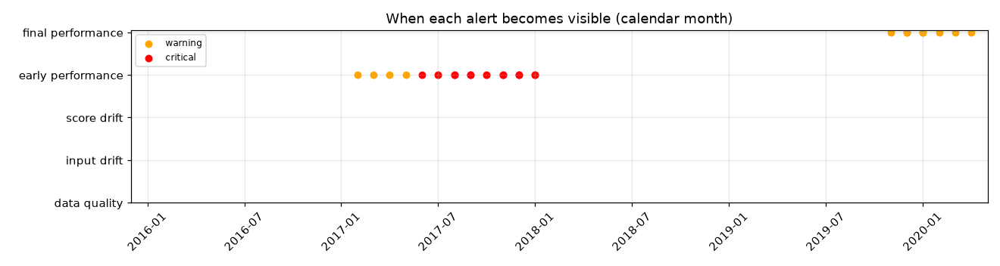
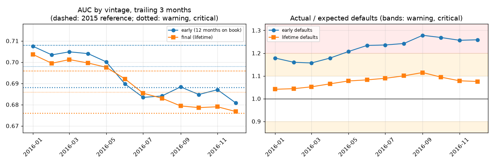

# Monitoring replay — 2016 as production traffic

> Generated by `python -m lc_risk.monitoring.simulate`. Do not edit by hand. The rules and
> the response playbook are in [README.md](README.md).

Model `lc-default-risk` v1.1.0. Reference: the 282,934 loans of the calibration year (2015). Production: 318,223 loans issued in 2016, replayed one issue month at a time. Performance metrics pool the trailing 3 vintages. Early labels are readable 13 months after issue; lifetime labels after 40.

## Headline

- **Ranking quality (AUC).** The early-label AUC fell past the warning line in data visible in **2017-07**. The same drop measured on lifetime outcomes became visible only in **2019-11**, **28 months later**.
- **Default level (actual / expected).** Early defaults ran above expectation from the first vintage (A/E 1.18, visible 2017-02), peaking at 1.28. Lifetime A/E peaked at only 1.11, first warning visible 2019-12. The early ratio points the right way but overstates the size, because 2016 defaults also came earlier in the loan's life than in 2015.
- **No data quality, input drift, score drift alert fired in any month.** The applications looked like the reference year while their outcomes did not, so monitoring the inputs alone would have missed this degradation.

## First alert per metric

| metric | layer | first warning visible | from vintage | first critical visible | from vintage  |
|---|---|---|---|---|---|
| rejected_share | data quality | — | — | — | — |
| max_input_psi | input drift | — | — | — | — |
| score_psi | score drift | — | — | — | — |
| early_ae | early performance | 2017-02 | 2016-01 | 2017-06 | 2016-05 |
| early_auc_drop | early performance | 2017-07 | 2016-06 | 2017-08 | 2016-07 |
| final_ae | final performance | 2019-12 | 2016-08 | — | — |
| final_auc_drop | final performance | 2019-11 | 2016-07 | — | — |

## Performance by vintage

Reference: early AUC 0.708, lifetime AUC 0.696.

## Data quality

216 of 318,223 applications (0.068%) would be rejected by the API, all for missing a required field (`dti`: 1, `revol_util`: 215). That is within the 0.5% the input contract tolerates, so no alert fired; whether those fields should become nullable is a product decision.

## Monthly metrics

| vintage | loans | rejected | max_input_psi | score_psi | mean_pd | early_ae | early_auc | final_ae | final_auc |
|---|---|---|---|---|---|---|---|---|---|
| 2016-01 | 22448 | 16 | 0.060 | 0.012 | 0.140 | 1.178 | 0.707 | 1.041 | 0.704 |
| 2016-02 | 28189 | 15 | 0.018 | 0.001 | 0.148 | 1.160 | 0.703 | 1.044 | 0.699 |
| 2016-03 | 43955 | 29 | 0.027 | 0.003 | 0.152 | 1.157 | 0.705 | 1.052 | 0.701 |
| 2016-04 | 27702 | 15 | 0.027 | 0.003 | 0.152 | 1.178 | 0.704 | 1.065 | 0.700 |
| 2016-05 | 21445 | 16 | 0.030 | 0.012 | 0.157 | 1.207 | 0.700 | 1.078 | 0.698 |
| 2016-06 | 24519 | 9 | 0.067 | 0.016 | 0.139 | 1.234 | 0.690 | 1.082 | 0.692 |
| 2016-07 | 25374 | 14 | 0.048 | 0.008 | 0.153 | 1.236 | 0.683 | 1.089 | 0.685 |
| 2016-08 | 27141 | 14 | 0.034 | 0.010 | 0.149 | 1.242 | 0.684 | 1.100 | 0.683 |
| 2016-09 | 21059 | 19 | 0.049 | 0.008 | 0.145 | 1.278 | 0.688 | 1.115 | 0.679 |
| 2016-10 | 24124 | 25 | 0.042 | 0.016 | 0.139 | 1.269 | 0.685 | 1.095 | 0.679 |
| 2016-11 | 25297 | 19 | 0.036 | 0.011 | 0.142 | 1.256 | 0.687 | 1.078 | 0.679 |
| 2016-12 | 26970 | 25 | 0.046 | 0.002 | 0.146 | 1.259 | 0.681 | 1.075 | 0.677 |

## Caveats

- The replay reads outcomes from the 2020Q3 snapshot, so it shows what *would* have been visible at each date; nothing here was observed live.
- The default month is approximated by the last payment date (see `lc_risk/monitoring/performance.py`).
- The reference year also served for calibration and early stopping, so its AUCs are slightly optimistic, which makes the AUC-drop alerts slightly more sensitive.
- The alert thresholds are conventional values fixed in `lc_risk/monitoring/rules.py`. One rule was corrected after the first replay: data quality originally fired on any rejected application, which contradicted the 0.5% tolerance built into the input contract.
