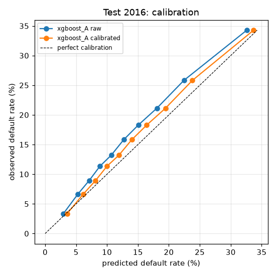
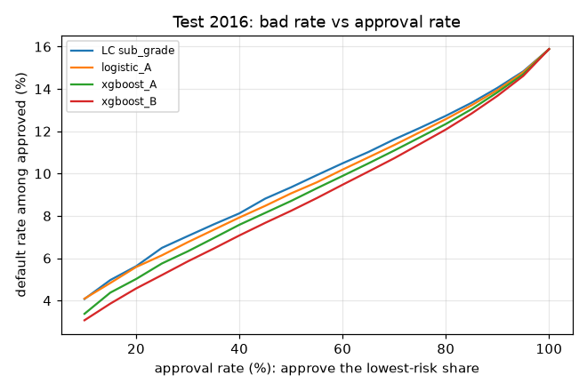

# Model card — lc-default-risk v1.1.0

## What it does

Predicts the probability that a 36-month individual Lending Club loan is charged off, from information available when the application is scored: 61 application and credit-bureau fields. It does **not** use LC's grade or interest rate. Output: a calibrated probability of default (PD) plus the top risk-increasing factors for that applicant (reason codes).

Accepted by the service but deliberately **not** used by the model: `addr_state`. Geography can proxy for protected characteristics, and state of residence is not a specific or actionable reason to give an applicant. Removed in v1.1.0.

Algorithm: XGBoost (865 trees, max depth 3), with monotone constraints on 12 features, followed by Platt calibration (slope 0.948, intercept +0.014).

## Changes in this version

Removed `addr_state` from the model inputs for fair-lending and explainability reasons ([amendment 1](../../docs/model_selection.md#amendment-1--remove-addr_state-decided-before-training-v110)). In v1.0.0 it appeared among the top three reason codes for most applicants. Cost on the 2016 test year: AUC 0.6895 → 0.6884 (paired bootstrap difference −0.0011, 95% CI −0.0018 to −0.0004). Lending outcomes are unchanged: at 80% approval the default rate is 12.35% → 12.34% and the realized return is +7.06% in both versions. Fitted models now store their input field list, so later schema changes cannot alter a released model.

## Intended use

- Ranking and pricing support for 36-month unsecured personal loans similar to LC's 2013–2016 book; portfolio-level expected-loss estimates.
- **Not** for: 60-month loans, joint applications, applicants outside LC's historical approval range (e.g. FICO < 660, DTI ≥ 40%), or as the sole basis of an adverse decision without human review.

## Data

- Train: loans issued 2013–2014; calibration/validation: 2015; out-of-time test: 2016 (318,223 loans, 15.9% default rate).
- Cohort definition and evidence: `discovery/reports/data_audit.md` and `discovery/eda.ipynb`. Selection rules, fixed before testing: `docs/model_selection.md`.

## Performance on the out-of-time test year

| | this model | logistic baseline | LC sub-grade ranking |
|---|---|---|---|
| AUC | 0.6884 | 0.6790 | 0.6723 |
| Gini | 0.3768 | 0.3581 | 0.3447 |
| KS | 0.2715 | | |

Validation AUC was 0.6959.
XGBoost vs the logistic baseline: +0.0094 AUC (95% CI +0.0082 to +0.0103).

**Value of LC's grade (ablation).** Adding `sub_grade` to the same model changes test AUC by +0.0120 (95% CI +0.0109 to +0.0130). This model deliberately does not use it; see `docs/model_selection.md`.

## Calibration

Test year: mean predicted PD 14.72% vs observed default rate 15.88%; expected calibration error 0.0120; Brier score 0.1256.

By issue quarter of the test year:

| quarter | loans | AUC | mean PD | default rate |
|---|---|---|---|---|
| 2016Q1 | 94,592 | 0.701 | 14.8% | 15.6% |
| 2016Q2 | 73,666 | 0.692 | 14.9% | 16.1% |
| 2016Q3 | 73,574 | 0.679 | 14.9% | 16.6% |
| 2016Q4 | 76,391 | 0.677 | 14.2% | 15.3% |

## Lending impact

Approving the 80% of test-year applicants with the lowest predicted risk:

| ranking | default rate among approved | realized return on approved book |
|---|---|---|
| this model | 12.34% | +7.06% |
| LC sub-grade | 12.73% | +6.46% |
| approve everyone | 15.88% | +5.91% |

Realized return uses each loan's actual repayments and recoveries over its life, not annualized.

## Explainability

Monotone constraints: `fico_range_low` (higher → less risk), `annual_inc` (higher → less risk), `mort_acc` (higher → less risk), `credit_history_months` (higher → less risk), `dti` (higher → more risk), `loan_to_income` (higher → more risk), `revol_util` (higher → more risk), `inq_last_6mths` (higher → more risk), `acc_open_past_24mths` (higher → more risk), `num_tl_op_past_12m` (higher → more risk), `delinq_2yrs` (higher → more risk), `pub_rec_bankruptcies` (higher → more risk).

Reason codes are exact TreeSHAP contributions computed by XGBoost, scaled by the calibration slope, so they are in calibrated log-odds.

| top drivers (mean abs contribution, test year) | |
|---|---|
| fico_range_low | 0.196 |
| dti | 0.142 |
| acc_open_past_24mths | 0.138 |
| loan_to_income | 0.128 |
| annual_inc | 0.119 |
| num_tl_op_past_12m | 0.100 |
| total_il_high_credit_limit | 0.096 |
| percent_bc_gt_75 | 0.091 |
| home_ownership | 0.085 |
| purpose | 0.084 |

## Where the performance ceiling is

Validation-year diagnostics (`lc_risk.training.diagnostics`):

| lever | effect on validation AUC |
|---|---|
| more training rows | 0.6824 (10%) → 0.6890 (25%) → 0.6927 (50%) → 0.6955 (100%); about +0.0039 per doubling |
| 10 hand-built ratio features | +0.0014 |
| hyperparameter tuning | best of 30 trials was #4 (random warm-up); top-5 spread 0.0014 |
| new information: LC's sub_grade | +0.0100 |

More rows, more features, and more tuning each add little; new information adds more. The ceiling is the information in application-time bureau data for an already-approved population, not the model. Gains would come from new sources (cash-flow data, trended bureau history, the bureau fields LC added in late 2015) rather than from modeling.

## Limitations and risks

- **Approved loans only.** Rejected applicants are absent from the data, so the model has not learned risk outside LC's approval range (no reject inference).
- **Drift.** Default rates rose within every LC grade from 2013 to 2016, and the calibration was fit on 2015. Expect under-prediction if the trend continues; recalibrate on the latest matured vintage.
- **Selection-encoded inputs.** `verification_status` reflects LC choosing to verify riskier applicants; it is predictive but not causal.
- **Fairness.** The data holds no protected attributes, so disparate impact cannot be measured directly. `addr_state` is excluded from the model; geography can still leak through correlated bureau fields, so monitor approval and default rates by state.
- **Serialization.** The model is a pickle; it loads only with the pinned scikit-learn and xgboost versions (checked at load time).

## Monitoring

Within the test year, AUC fell from 0.701 (2016Q1) to 0.677 (2016Q4), while the score PSI between validation and test was only 0.0013. **Input and score drift monitoring alone would not have caught this.** In production, track input PSI per field and score PSI per batch (alert above 0.25), and compare predicted PD with the realized default rate and AUC as each vintage's labels mature.

## Follow-up work

- Refit on 2013–2015 and recalibrate on the newest matured vintage, with a fresh holdout.
- A separate model for 60-month loans on an earlier cohort.

## Provenance

- Training run `v1.1-no-state`; code commit `ae4c804834e004e9098f2a886f80152019d6ac50` (dirty: False), package source SHA-256 `04c16db0d2bf9a252c1154fcb2623721a93f8b9214afe4f06a916b97fbbea703`
- Cohort `cohort.parquet` SHA-256 `1c10b1db261dc015f802b05ef050bbcf642cd26633575cfe71859d69a05d1d02`
- Libraries: scikit-learn 1.9.1, xgboost 3.4.1, optuna 5.0.0, pandas 3.1.0, numpy 2.5.4
- Full reports: [validation](validation_report.md), [test](test_report.md)
