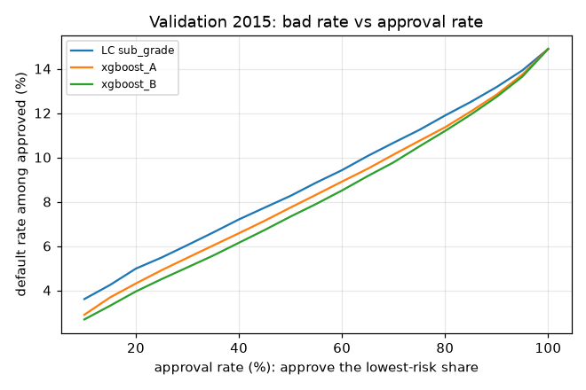
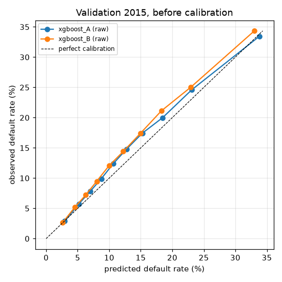

# Validation report — run `v2-release`

Train 2013–2014, validation 2015. The test year was not used. Calibration is fit on the validation year, so calibration metrics here are shown **before** calibration; calibrated metrics are only meaningful on the test year.

| model | AUC | Gini | KS | mean PD (raw) | ECE (raw) |
|---|---|---|---|---|---|
| logistic_A | 0.6879 | 0.3759 | 0.2742 | 0.1353 | 0.0136 |
| xgboost_A | 0.6973 | 0.3945 | 0.2857 | 0.1378 | 0.0119 |
| xgboost_A_unconstrained | 0.6989 | 0.3978 | 0.2888 | 0.1378 | 0.0114 |
| logistic_B | 0.7030 | 0.4059 | 0.2945 | 0.1322 | 0.0167 |
| xgboost_B | 0.7078 | 0.4157 | 0.3039 | 0.1328 | 0.0161 |
| xgboost_B_unconstrained | 0.7091 | 0.4183 | 0.3045 | 0.1336 | 0.0155 |

Validation default rate: 0.1489. Optuna trials per variant: 30.

## Bad rate at 80% approval

| ranking | bad rate |
|---|---|
| LC sub_grade | 0.1189 |
| xgboost_A | 0.1136 |
| xgboost_B | 0.1119 |

